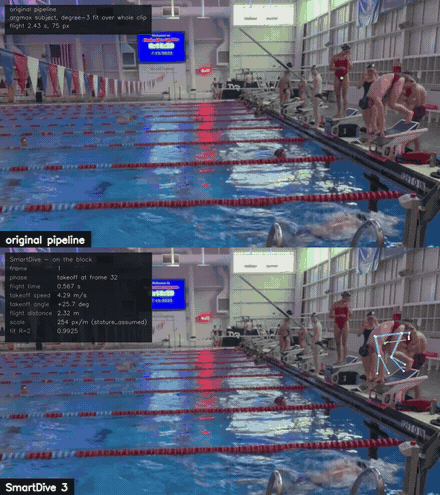
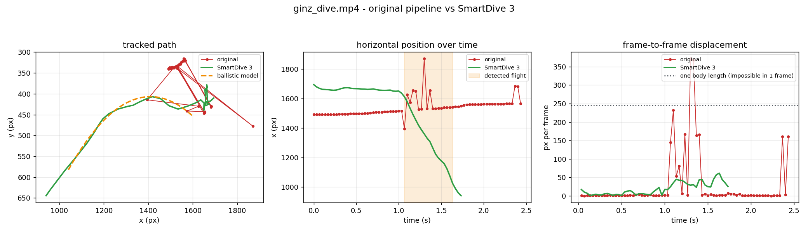

<h1 align="center">SmartDive</h1>

<p align="center">
  <b>Swim start analysis from ordinary poolside video, with the physics enforced.</b>
</p>

<p align="center">
  <a href="https://github.com/strdaniil/smartdive3/actions/workflows/ci.yml"></a>
  <a href="https://www.python.org/downloads/"></a>
  <a href="LICENSE"></a>
  <a href="https://github.com/astral-sh/ruff"></a>
</p>

<p align="center">
  
</p>
<p align="center">
  <sub><b>Top:</b> the original pipeline, its trail tangled on the swimmers behind the blocks.
  <b>Bottom:</b> SmartDive 3 tracking the diver through takeoff and flight.</sub>
</p>

Point it at a clip of a racing start. It finds the athlete, subtracts the
camera's own motion, works out which frames they were airborne, fits the
projectile model to their flight, and reports takeoff speed, takeoff angle,
flight time and flight distance in SI units, each with its calibration source
and an uncertainty next to it.

```bash
pip install "smartdive[yolo] @ git+https://github.com/strdaniil/smartdive3"
smartdive analyze start.mp4 --overlay --stature-m 1.85
```

```
SmartDive 3.1.0  |  adive.mp4
1920x1080 @ 30 fps, 48 frames  |  analysed in 0.4 s
subject: track 1 of 6 (37 detections, 3.5 body lengths travelled, peak 7.4 body lengths/s)
signal: 60% coverage, jitter 23.9 -> 8.8 px, 8 frames interpolated, camera drift 61 px removed
refine: 0 frames recovered, 16 improved, 19 unchanged
scale:  429 px of stature from 10 segments (spread 4%)

Block time                 0.433 s
Flight time                0.400 s
Takeoff speed              4.53 m/s
Takeoff angle              +25.6 deg
  horizontal               4.08 m/s
  vertical                 +1.95 m/s
Flight distance            1.63 m
Peak height above takeoff  0.19 m
Entry angle                25.8 deg
Airborne frames            13 to 25
Front knee angle at set    113.4 deg
Scale                      207.5 px/m via stature
Fit quality                R^2 = 0.9893, RMS 11.0 px

95% CI on takeoff angle: +23.4 to +27.6 deg
```

## What it does differently

This is a rewrite of an earlier project of mine ([`smartdive`](https://github.com/strdaniil/smartdive),
its `smartdive_v2` follow-up, and [diver-pro](https://www.diver-pro.net/)). Those
versions ran pose estimation and drew a line on the video. The line looked
convincing. The numbers underneath it were not.

<p align="center">
  
</p>
<p align="center">
  <sub>The same clip, both trajectories. The original (left) never settles on the
  diver; SmartDive 3 (right) follows one athlete from block to water.</sub>
</p>

The old code still printed a confident result on that clip: flight time 2.43 s,
horizontal distance 75 px. That follows from four design decisions, each fixed
here.

**The subject is chosen once, not per frame.** The old code took
`argmax(confidence)` in each frame with no association between frames, so the
trajectory hopped to whoever was best lit. On the sample clips that was the
diver in only 2% to 40% of frames. Now detections are associated into tracks,
fragments of one person are stitched back together, and the athlete is chosen
for the whole clip by peak speed in body lengths per second. Divers reach three
to eight; someone walking the deck reaches one; someone on a block reaches none.

**Flight time is measured, not the length of the clip.** The old code called
flight the span between the first and last frame with any measurement, which for
a person visible throughout is the whole video. Now takeoff and entry are each
detected from their own cue: entry from the collapse in visible body mass when
the athlete breaks the surface, takeoff from the per-frame fit residual climbing
while a foot is still driving off the block.

**The model is the physics.** The old code fit a degree-3 polynomial to the
whole clip, whose coefficients mean nothing for a body in free flight. Now the
model is the motion the body actually obeys, and its coefficients are the takeoff
velocity:

```
x(t) = x0 + vx*t
y(t) = y0 + vy*t + 0.5*g*t^2        (image y grows downward)
```

**Everything is in SI units.** The old output was "horizontal distance 431.2 px",
which depends on where the camera stood and cannot be compared between clips.
Everything is now in metres and seconds, and every report states which
calibration produced it. The camera motion and the clock are measured too, not
assumed; see [Camera and slow motion](#camera-and-slow-motion).

## What the run produces

Every analysis writes a JSON report, a per-frame CSV labelled `block` /
`flight` / `water`, an optional annotated video, and this diagnostic figure:

<p align="center">
  
</p>

The bottom-middle panel reads first: residuals inside a few percent of body
length mean the projectile model explains the motion and the metrics are sound;
structure in them means it does not. The top-right panel shows the water-entry
cue firing, and the bottom-right shows how much camera motion was removed.

## Results on the original project's footage

Both pipelines run over the **same pose detections**, so nothing here turns on a
better detector. `smartdive.legacy` re-implements the old code faithfully (same
0.5 confidence gate, argmax subject rule, degree-3 fit, metric definitions), so
the table is reproducible:

```bash
python benchmarks/run_benchmark.py videos/*.mp4 videos/*.mov --cache .cache
```

| clip | | looking at the diver | path travelled | jitter | flight phase | result |
|---|---|---|---|---|---|---|
| **`adive.mp4`**<br><sub>48 frames</sub> | original | 14% of frames | 0.86 body lengths | 38.7 px | whole clip (0-47) | 1.57 s, 3 px |
| | **SmartDive 3** | by construction | **2.98** body lengths | **8.8** px | frames 13-25 | 0.40 s, 4.4 m/s, 1.6 m |
| **`adive_wide.mov`**<br><sub>138 frames</sub> | original | 40% of frames | 1.27 body lengths | 29.5 px | whole clip (0-137) | 4.57 s, 42 px |
| | **SmartDive 3** | by construction | **3.57** body lengths | **4.4** px | frames 61-69 | 0.27 s, 5.0 m/s, 1.3 m |
| **`adive2.mp4`**<br><sub>192 frames</sub> | original | 11% of frames | 0.83 body lengths | 19.6 px | whole clip (0-191) | 6.37 s, 3 px |
| | **SmartDive 3** | by construction | **3.13** body lengths | **5.0** px | frames 47-103 | 0.47 s, 4.2 m/s, 1.7 m<br><sub>at 120 fps capture</sub> |
| **`ginz_dive.mp4`**<br><sub>74 frames</sub> | original | 2% of frames | 2.05 body lengths | 143.6 px | whole clip (0-73) | 2.43 s, 75 px |
| | **SmartDive 3** | by construction | **3.26** body lengths | **9.9** px | frames 32-49 | 0.57 s, 4.3 m/s, 2.3 m |
| **`test1.mp4`**<br><sub>105 frames</sub> | original | 36% of frames | 2.14 body lengths | 107.6 px | whole clip (0-104) | 4.08 s, 513 px |
| | **SmartDive 3** | by construction | **1.72** body lengths | **3.5** px | frames 36-97 | 0.51 s, 3.9 m/s, 1.9 m<br><sub>at 120 fps capture</sub> |

Path travelled exposes the subject failure: on `adive.mp4` the original covers
0.86 body lengths where the diver covers 2.98, and it reports the dive as 3 px
long. On `ginz_dive.mp4` the original's path (2.05) looks respectable, but its
jitter is 144 px, more than half a body length per frame, so that displacement
is the trajectory ricocheting between people rather than travel. The jitter
column is what tells them apart.

### Is any of it right?

There is no tape measure in this footage, so no ground truth. But two of the
sample clips are the *same dive*: `adive.mp4` in real time and `adive2.mp4`
exported at four times slow motion. Every disagreement between them is the
pipeline's own error, and getting them to agree requires the slow-motion
detection to recover 120 fps from a container insisting on 30.

| quantity | `adive.mp4` | `adive2.mp4` | agreement |
|---|---|---|---|
| capture rate recovered | 30 fps | 120 fps | correct 4x ratio |
| flight time | 0.400 s | 0.467 s | 17% |
| takeoff speed | 4.39 m/s | 4.23 m/s | **4%** |
| flight distance | 1.57 m | 1.65 m | **5%** |

Speeds and distances agree to within 5%. The flight window agrees to about two
frames at 30 fps, which is where the 17% on flight time comes from and why the
timings are quoted with error bars.

## Camera and slow motion

Two assumptions that every earlier version made silently, and that phone footage
routinely breaks.

**The camera is not bolted down.** Whoever is filming pans to keep the athlete in
shot, starting the pan the moment the athlete leaves the block, which puts a
camera acceleration inside the flight window where the fit cannot separate it
from the athlete's own motion. On the sample clips the background drifts 40 to
260 px. So the camera is measured and subtracted: sparse features are tracked
between frames, everything inside a detected person's box is discarded, and a
similarity transform is fitted by RANSAC to what is left. Composing those warps
gives a synthetic locked-off tripod.

**The container frame rate is not the capture rate.** A clip shot in a phone's
slow-motion mode carries the rate it will be played at, so times and speeds come
out wrong by that factor with nothing in the pixels to say so. Gravity provides
an independent clock. Having pinned the scale from the athlete's body, a body in
free fall shows apparent vertical acceleration `g * px_per_metre * k^2`, so
`k = sqrt(a_y / (g * px_per_metre))` and the true rate is `container_fps / k`.
On the sample footage this recovers 120 fps on both slow-motion clips and leaves
the three real-time clips alone. It is applied only when the fitted acceleration
is itself well determined, so ordinary 30 fps footage cannot wrongly declare
itself slow motion.

## Install

```bash
git clone https://github.com/strdaniil/smartdive3
cd smartdive3
python -m venv .venv && source .venv/bin/activate    # Windows: .venv\Scripts\activate
pip install -e ".[yolo]"
```

`[yolo]` pulls in `ultralytics` and `torch`. For a CPU-only, torch-free setup,
use `pip install -e ".[mediapipe]"` and pass `--backend mediapipe`. Model weights
download on first run.

## Use

```bash
# Full analysis with an annotated video
smartdive analyze start.mp4 --overlay -o output/

# Exact metres: give it a length you measured in the frame
smartdive analyze start.mp4 --reference-px 512 --reference-m 2.5   # lane width

# Or the athlete's height, usually easier to find out
smartdive analyze start.mp4 --stature-m 1.83

# Cache detections and camera motion, so re-runs are instant
smartdive analyze start.mp4 --cache .cache

# Track something other than the centre of mass
smartdive analyze start.mp4 --landmark hips

# Override the phase detection
smartdive analyze start.mp4 --flight-window 14:26

# Escape hatches, if a clip defeats the automatic version
smartdive analyze start.mp4 --capture-fps 240 --no-depth-scale --no-refine
```

From Python:

```python
from smartdive import analyze

result = analyze("start.mp4", cache=".cache")

print(result.metrics.format_table())
print(result.metrics.takeoff_speed_ms)       # 4.53
print(result.fps)                             # capture rate, after slow-mo detection
print(result.uncertainty["angle_deg"])        # (23.4, 27.6)
print(result.quality())                       # coverage, jitter, identity errors, drift
for warning in result.warnings:
    print(warning)
```

## How it works

| stage | module | what it does |
|---|---|---|
| detection | `backends/` | YOLO or MediaPipe, normalised to COCO-17 |
| camera | `camera.py` | background similarity transform per frame, RANSAC |
| association | `tracking.py` | constant-velocity tracks, Hungarian assignment |
| stitching | `tracking.py` | reconnect fragments of the same person |
| subject choice | `tracking.py` | one decision per clip, by peak body-length speed |
| refinement | `refine.py` | second pose pass on a crop that follows the athlete |
| skeleton | `pose.py` | complete and condition all 17 keypoints, then the CoM |
| scale | `anthro.py` | stature from bone lengths; per-frame size for depth |
| phase | `physics.py` | visibility for entry, per-frame residual for takeoff |
| clock | `calibration.py` | recover the capture rate of slow-motion footage |
| metrics | `metrics.py` | SI kinematics plus bootstrap intervals |

A few details worth calling out; [`docs/method.md`](docs/method.md) has the rest.

**The detector gets a second look.** A whole-frame pass spends its resolution on
the whole frame, and the part that needs it most, a motion-blurred body over the
water, is where it fails. On `ginz_dive.mp4` the first pass stops reporting the
diver ten frames before entry. So once the athlete is identified, the video is
read again at a crop that follows them, upscaled to fill the network's input.

**Keypoints are conditioned before the centre of mass, not after.** The CoM is a
weighted sum over body segments; if a segment drops out of a frame the sum runs
over a different set of segments and moves even when the athlete does not.
Conditioning each of the 17 keypoints as its own series first, filling a missing
one from its contralateral partner, keeps the same segments contributing in
every frame.

**The scale comes from bone lengths, not bounding boxes.** A bounding box is
pose-dependent by a factor of three between a crouch and a streamline.
Individual segments are fixed fractions of stature whatever the athlete is
doing, and projection can only shorten them, so a high percentile of each
segment's observed length estimates its true length. See
[Calibration](#calibration) below.

## Calibration

**Tell it the athlete's height.** One flag, and the single most useful thing you
can supply:

```bash
smartdive analyze start.mp4 --stature-m 1.85
```

Without it, a height of 1.78 m is assumed (roughly the mean for adult
competitive swimmers) and distances and speeds carry about 15% error. With it,
about 5%. Times and angles are unaffected either way, so a wrong height corrupts
only the speeds and leaves the flight time, takeoff angle and phase boundaries
exactly right.

A single camera cannot recover scale: a 1.8 m athlete far away and a 0.9 m doll
near the lens produce identical pixels, because projection collapses size and
distance into one number. Every scale estimate is therefore a choice of what to
assume. SmartDive assumes the athlete's proportions and, failing better
information, their height.

The athlete becomes a ruler through their bones, each a fixed fraction of
standing height (Winter, *Biomechanics and Motor Control of Human Movement*):

```
thigh (hip to knee)    0.245 of stature      upper arm   0.186
shank (knee to ankle)  0.246                  forearm     0.146
hip to ankle           0.491                  trunk       0.270
```

The chain for one clip, with real numbers from `adive.mp4`:

```
video       ->  left thigh measured at 94.5 px       (the only measurement)
Winter      ->  / 0.245  =  386 px of stature        (no height assumed yet)
your input  ->  / 1.85 m  =  207.5 px/m              (the assumption, one division)
                every distance / 207.5
```

The assumed height enters once, at the end. Steps one and two say "this athlete
is 386 pixels tall", a genuine measurement of your video that is the same number
whether the swimmer is 1.60 m or 2.00 m. Only the last division needs to know
which.

Two statistics measure the bones. **Within a segment, across frames, the 85th
percentile:** projection only ever shortens, so every frame underestimates and
the top of the distribution is the truth; the 85th percentile skips the
foreshortened frames without landing on whichever frame the detector blew out.
**Across segments, a weighted median with a trim:** ten segments give ten
stature estimates, combined by a median weighted towards the long leg segments,
with any segment more than 35% from consensus dropped. A mislocated wrist once
made a forearm read 1047 px, implying a seven-metre athlete; the median did not
notice.

Checked against a standing bystander in `adive.mp4`, whose eye-to-ankle height
can be measured directly, the estimate lands within 2%.

The three calibration routes, in order of preference:

| method | you supply | error on distances | flag |
|---|---|---|---|
| `reference` | a length you measured in the frame | your tape measure | `--reference-px 512 --reference-m 2.5` |
| `stature` | the athlete's height | ~5% | `--stature-m 1.85` |
| `stature_assumed` | nothing | ~15% | *(default, 1.78 m)* |

A reference is the best one-time investment: measure one lane width at the
diver's depth in a single frame and it removes the last assumption for that
camera position. Competition lanes are 2.5 m; many US pools are 7 ft (2.13 m),
so check rather than guess. A height in centimetres is caught, not used:
`--stature-m 185` is rejected with a message naming the likely mistake, because
a units slip here is a factor of a hundred and nothing downstream would notice.

Gravity is not used for scale. Over a 0.4 s flight at 30 fps a parabola departs
from its own chord by about 42 px, while keypoint noise is 10 to 16 px, so
refitting the same trajectory over windows a frame apart swings the gravity
scale by a factor of 2.3 where body scale holds to 3%. Gravity is computed and
reported as a cross-check only. Its one good job is the reverse: on
high-frame-rate footage, where the curvature is well determined, the same
equation recovers the clock instead of the ruler. Full detail in
[`docs/method.md`](docs/method.md).

## Known limits

Stated up front, because a measurement tool that hides its error bars is worse
than one that has none.

- **Entry timing** is accurate to about 3 frames (0.1 s at 30 fps). The
  visibility cue fires slightly before full immersion; the window is then
  extended forward while the trajectory still fits.
- **Takeoff timing** is accurate to about 2 frames at 30 fps, where the block
  push is compressed into a few frames. On high-frame-rate footage it is less
  sharp: the push resolves over dozens of frames and a parabola fits part of it,
  so expect takeoff a few hundredths early. The guard is that the athlete must
  already be past half their takeoff speed at the frame called takeoff;
  `--flight-window` is the fix when that is not enough.
- **Absolute distances** carry the calibration's uncertainty: roughly 15%
  without a reference length, 5% with `--stature-m`, your own accuracy with a
  measured reference.
- **Out-of-plane motion is invisible to one camera.** The depth correction fixes
  the scale of an athlete travelling away from the camera but cannot recover the
  velocity component pointing into the frame, so speeds from an obliquely filmed
  start are a lower bound and the report says so.
- **Single start per clip.** Trim first if the video contains several. Several
  *swimmers* in one clip are fine; that is the whole point.
- **The knee-angle band (125-150 deg)** is inherited from the original project's
  heuristic, kept for continuity. It is not clinical advice.

For the best numbers: film square-on to the lane from a fixed position, in slow
motion if the phone offers it, and pass `--stature-m`.

## Repository layout

```
src/smartdive/        the package; one module per pipeline stage (table above)
tests/                pytest suite, backend stubbed (no weights, no footage)
  synthetic.py        the proportioned synthetic athlete the stubs are built on
benchmarks/           old-vs-new comparison and demo rendering; needs footage
  run_benchmark.py    the results table, reproducibly
  make_demos.py       the side-by-side videos and the GIF
examples/quickstart.py  one clip, everything the pipeline knows about it
docs/method.md        why each stage is built the way it is
videos/               your clips (gitignored)
assets/               committed figures and the README GIF
```

## Development

```bash
pip install -e ".[all]"
pytest                                   # ~110 tests, no weights needed
ruff check src tests benchmarks
python benchmarks/run_benchmark.py videos/*.mp4 videos/*.mov --cache .cache
python benchmarks/make_demos.py videos/adive.mp4 --cache .cache
```

The suite stubs the pose backend with an anatomically proportioned synthetic
athlete, so CI needs neither torch nor network access. Because the stub is
generated at a known pixel stature, "analyse it and see whether the calibration
finds that stature again" is a real test rather than a tautology. See
[CONTRIBUTING.md](CONTRIBUTING.md).

## Licence

MIT, see [LICENSE](LICENSE).

Built on [Ultralytics YOLO](https://github.com/ultralytics/ultralytics) and
[MediaPipe](https://github.com/google-ai-edge/mediapipe). Segment inertial
parameters and stature ratios from Winter, *Biomechanics and Motor Control of
Human Movement*.
