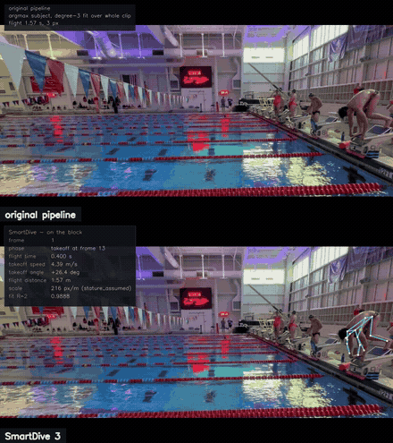
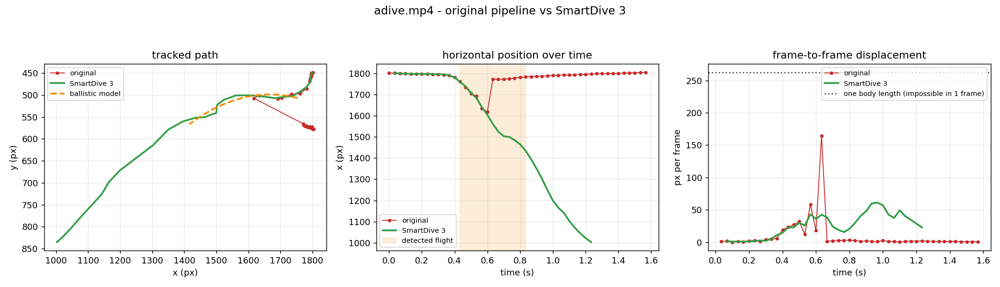

# SmartDive

**Swim start analysis from ordinary poolside video — with the physics actually enforced.**

[](https://github.com/strdaniil/smartdive3/actions/workflows/ci.yml)
[](https://www.python.org/downloads/)
[](LICENSE)
[](https://github.com/astral-sh/ruff)

Point it at a clip of a racing start and it finds the athlete, works out which
frames they were airborne, fits the projectile model to their flight, and
reports takeoff speed, takeoff angle, flight time and flight distance in SI
units — with the calibration source and an uncertainty stated next to them.

```bash
pip install "smartdive[yolo] @ git+https://github.com/strdaniil/smartdive3"
smartdive analyze start.mp4 --overlay
```

```
Block time                 0.433 s
Flight time                0.400 s
Takeoff speed              5.50 m/s
Takeoff angle              +10.6 deg
  horizontal               5.40 m/s
  vertical                 +1.01 m/s
Flight distance            2.16 m
Peak height above takeoff  0.05 m
Entry angle                28.3 deg
Airborne frames            13 to 25
Front knee angle at set    113.4 deg
Scale                      156.1 px/m via stature_assumed
Fit quality                R^2 = 0.9707, RMS 18.6 px

95% CI on takeoff angle: +8.5 to +13.2 deg
  ! gravity calibration (93 px/m) disagrees with the body-scale prior
    (156 px/m) by 40%; the flight is too short at this frame rate to measure
    curvature reliably, so the prior was used.
  ! absolute distances assume a 1.75 m athlete; pass --stature-m or
    --reference-px/--reference-m to make them exact. Times and angles are
    unaffected.
```

---

## Why this exists

This is a rewrite of an earlier project of mine ([`smartdive`](https://github.com/strdaniil/smartdive)
and its `smartdive_v2` follow-up). Those versions ran pose estimation and drew a
line on the video, and the line looked convincing. The numbers underneath it
were not.

The clearest example is in the sample footage. Here is the same dive through the
old pipeline and this one:



The top pane is the original code. Its green trail is a small tangle on the
right, drawn on **a bystander standing on the pool deck**, while the diver flies
past unmeasured. It still printed a confident-looking result: *flight time 1.57
seconds, horizontal distance 3 pixels.*

That is not a tuning problem. It follows from three decisions in the original
design, each of which is fixed here.

### 1. The subject was chosen independently in every frame

`process_video.py` took `argmax(confidence)` over the detections in each frame,
with no association between frames. A well-lit spectator is a far easier
detection than a motion-blurred athlete at full extension, so the moment the
dive gets interesting, the "trajectory" hops to somebody else.

Measured on the sample clips, per-frame argmax was looking at the diver in
**1% to 79% of frames** depending on the clip.

Now: detections are associated into tracks with a constant-velocity model and
Hungarian assignment, and the athlete is chosen **once for the whole clip** as
the track that travels furthest in body lengths. Divers cover two to four body
lengths during a start. Spectators cover none.



The centre panel shows it happening: the red trace follows the diver, then snaps
back 165 px in a single frame and flatlines for the rest of the clip. The right
panel marks one body length — a displacement a human cannot produce in 1/30 s,
and therefore a direct, assumption-free count of identity errors.

### 2. "Flight time" was the length of the clip

`compute_metrics.py` defined flight as the span between the first and last frame
that produced *any* measurement. If a person was visible in frame 0 and in the
last frame, that is the whole video.

Now: takeoff and entry are detected, using a different cue for each, because
each cue is sharp at one end and blind at the other.

- **Takeoff** comes from the physics. While a foot is still on the block the
  athlete is being accelerated by their legs, which a constant-acceleration
  model cannot express, so the fit residual rises steeply — in the sample clip
  from 16 px to 260 px within a few frames of the break.
- **Entry** comes from visibility. A streamlined swimmer in the first tenth of a
  second underwater is still travelling on very nearly a parabola, so the
  residual cannot see the water. But a pose detector can only label joints it
  can see, so the fraction of body mass it resolves falls off a cliff — from
  1.00 to 0.35 in one frame — the instant the athlete breaks the surface.

### 3. A cubic was fit to the whole clip

`polyfit.py` fit `numpy.polyfit(t, x, 3)` and `numpy.polyfit(t, y, 3)`. A cubic
has no physical meaning for a body in free flight, so its coefficients cannot be
turned into a velocity, an angle or a scale — and fitting across the block,
flight and water phases produces a curve that describes none of them.

Now the model is the one the motion actually obeys:

```
x(t) = x0 + vx·t
y(t) = y0 + vy·t + ½·g·t²        (image y grows downward)
```

Its coefficients *are* the takeoff velocity. Its residual tells you which frames
were airborne. And because the quadratic term must equal gravity, the fit also
measures the scene's pixels-per-metre — see [Calibration](#calibration) for how
far that can be trusted.

### 4. Everything was in pixels

The old output was "horizontal distance: 431.2 px". That depends on where the
camera was standing, so two clips of the same athlete could not be compared and
no coach could act on it. Everything is now in metres and seconds, and every
report states which calibration produced them.

---

## Results on the original project's own footage

Both pipelines run over the **same pose detections**, so nothing here turns on
one of them having had a better detector. `smartdive.legacy` is a faithful
re-implementation of the old code — same 0.5 confidence gate, same argmax
subject rule, same degree-3 fit, same metric definitions — so this table is
reproducible rather than asserted:

```bash
python benchmarks/run_benchmark.py videos/*.mp4 --cache .cache
```

| clip | | looking at the diver | path travelled | jitter | flight phase | result |
|---|---|---|---|---|---|---|
| **`adive.mp4`**<br><sub>48 frames</sub> | original | 51% of frames | 0.86 body lengths | 37.3 px | whole clip (0-47) | 1.57 s, 3 px |
| | **SmartDive 3** | by construction | **3.38** body lengths | **10.1** px | frames 13-25 | 0.40 s, 5.5 m/s, 2.2 m |
| **`adive_wide.mov`**<br><sub>138 frames</sub> | original | 79% of frames | 1.24 body lengths | 21.5 px | whole clip (0-137) | 4.57 s, 42 px |
| | **SmartDive 3** | by construction | **4.08** body lengths | **6.4** px | frames 60-70 | 0.33 s, 6.3 m/s, 2.1 m |
| **`ginz_dive.mp4`**<br><sub>74 frames</sub> | original | 1% of frames | 2.15 body lengths | 150.5 px | whole clip (0-73) | 2.43 s, 75 px |
| | **SmartDive 3** | by construction | **0.79** body lengths | **6.6** px | frames 24-35 | 0.37 s, 2.6 m/s, 1.0 m |
| **`adive2.mp4`**<br><sub>192 frames</sub> | original | 52% of frames | 0.86 body lengths | 19.2 px | whole clip (0-191) | 6.37 s, 3 px |
| | **SmartDive 3** | by construction | **3.40** body lengths | **7.5** px | **not found** | **not found** |
| **`test1.mp4`**<br><sub>105 frames</sub> | original | 76% of frames | 1.35 body lengths | 19.9 px | whole clip (0-104) | 4.08 s, 284 px |
| | **SmartDive 3** | by construction | **0.81** body lengths | **4.7** px | **not found** | **not found** |

Reading the table honestly:

- **Path travelled** exposes the subject failure. On `adive.mp4` the original's
  trajectory covers 0.86 body lengths where the diver covers 3.38, and it
  reports the dive as 3 px long. On `adive2.mp4`, the same.
- **`ginz_dive.mp4` needs care.** The original's path travelled (2.15) looks
  *larger* than the new one (0.79) — but its jitter is 150 px, more than half a
  body length per frame, and it agreed with the diver in 1% of frames. That
  displacement is not travel, it is the trajectory ricocheting between different
  people. The jitter column is what tells them apart.
- **Two clips return "not found", and that is the intended behaviour.** See
  below.

### Where it does not work

`adive2.mp4` and `test1.mp4` produce no automatic result. Both contain long
approaches with only a few frames of clean airborne trajectory, and rather than
emit a number it cannot support, the detector declines and says so in
`warnings`. The old pipeline had no way to decline: it always printed something.

When you can see the dive but the detector will not commit, name the window:

```bash
smartdive analyze videos/adive2.mp4 --flight-window 85:104
```

That path runs the same model, the same calibration and the same uncertainty
estimate — it only skips the search.

---

## Install

```bash
git clone https://github.com/strdaniil/smartdive3
cd smartdive3
python -m venv .venv && source .venv/bin/activate    # Windows: .venv\Scripts\activate
pip install -e ".[yolo]"
```

`[yolo]` pulls in `ultralytics` and `torch`. For a CPU-only, torch-free setup use
`pip install -e ".[mediapipe]"` and pass `--backend mediapipe`. Model weights
download on first run.

## Use

```bash
# Full analysis with an annotated video
smartdive analyze start.mp4 --overlay -o output/

# Exact metres: give it a length you measured in the frame
smartdive analyze start.mp4 --reference-px 512 --reference-m 2.5   # lane width

# ...or the athlete's height
smartdive analyze start.mp4 --stature-m 1.83

# Track something other than the centre of mass
smartdive analyze start.mp4 --landmark hips

# Override the phase detection
smartdive analyze start.mp4 --flight-window 14:26
```

From Python:

```python
from smartdive import analyze

result = analyze("start.mp4", cache=".cache")

print(result.metrics.format_table())
print(result.metrics.takeoff_speed_ms)       # 5.50
print(result.uncertainty["angle_deg"])       # (8.5, 13.2)
print(result.quality())                      # coverage, jitter, identity errors
for warning in result.warnings:
    print(warning)
```

Each run writes a JSON report (metrics, the full track ranking, signal quality,
provenance and warnings), a per-frame CSV labelled `block` / `flight` / `water`,
and a diagnostic figure:


The bottom-right panel is the one to read first. Residuals sitting inside a few
percent of body length mean the projectile model explains the motion and the
metrics are sound; structure in them means it does not.

---

## How it works

| stage | module | what it does |
|---|---|---|
| detection | `backends/` | YOLO or MediaPipe, normalised to COCO-17 |
| association | `tracking.py` | constant-velocity tracks, Hungarian assignment |
| subject choice | `tracking.py` | one decision per clip, by distance travelled |
| landmark | `com.py` | whole-body centre of mass from segment masses |
| conditioning | `signal.py` | Hampel reject → PCHIP fill → Savitzky-Golay smooth |
| phase | `physics.py` | ballistic seed, RANSAC consensus, visibility for entry |
| scale | `calibration.py` | reference, stature, or gravity — with a cross-check |
| metrics | `metrics.py` | SI kinematics plus bootstrap intervals |

Three details worth calling out; [`docs/method.md`](docs/method.md) has the rest.

**The landmark is the centre of mass, not a joint.** Tracking the hip midpoint
couples the measurement to body *rotation*: a diver who pikes or extends moves
their hips relative to their true centre of mass, which appears as a
non-ballistic wobble. Summing anthropometric segment masses over all 17
keypoints removes most of that, and averages independent per-joint detector
noise down by roughly `sqrt(n)`.

**Every threshold is subject-relative.** Tolerances are expressed in body
lengths or in units of the estimated measurement noise, never in raw pixels, so
nothing needs retuning for a different resolution or camera distance.

**Smoothing is order-2 Savitzky-Golay, and that is not arbitrary.** A degree-2
filter reproduces constant-acceleration motion *exactly*, so conditioning a
projectile trajectory cannot bias the gravity estimate the physics stage
depends on. There is a test for it.

---

## Calibration

Three ways to get from pixels to metres, in order of preference:

| method | needs | accuracy |
|---|---|---|
| `reference` | a known length measured in the frame | best |
| `stature` | the athlete's height | good |
| `gravity` | nothing | see below |

Gravity calibration is the appealing one: free flight has a known vertical
acceleration, so `px_per_metre = a_y / 9.80665` and the scene calibrates itself
with no user input at all. It is also the least dependable on ordinary footage,
for a reason worth stating plainly rather than hiding.

Over a flight of duration `T`, a parabola departs from its own chord by only
`a·T²/8`. A racing start at 30 fps gives `T ≈ 0.35 s`, putting that departure at
roughly 25 px — the same order as the keypoint noise. The estimate is therefore
poorly conditioned, and on the sample clips it swings by a factor of 2.6
depending on exactly which frames the window includes.

So SmartDive does two things about it. The flight fit **holds `a_y` fixed** from
an independent body-scale prior, which removes the degeneracy and sharpens the
residual into a usable test of whether a frame was airborne. And the gravity
estimate is accepted as the reported scale **only when it agrees with that prior
to within 35%**; otherwise the prior is used and the report says so:

```
! gravity calibration (93 px/m) disagrees with the body-scale prior (156 px/m)
  by 40%; the flight is too short at this frame rate to measure curvature
  reliably, so the prior was used. Pass --reference-px/--reference-m for an
  exact scale.
```

Gravity calibration becomes genuinely good on high-frame-rate video, where `T`
is sampled far more finely and the noise is relatively smaller.

**Times and angles do not depend on the scale at all.** Flight time, takeoff
angle, entry angle and phase boundaries are exact regardless of calibration;
only the distances and speeds inherit its uncertainty.

## Known limits

Stated up front, because a measurement tool that hides its error bars is worse
than one that has none.

- **Entry timing is accurate to about ±3 frames** (0.1 s at 30 fps). The
  visibility cue fires when the athlete's lower body stops being detectable,
  which slightly precedes full immersion.
- **Absolute distances carry the calibration's uncertainty.** Without a
  reference length, expect roughly ±15%. With one, expect the accuracy of your
  measurement.
- **The motion must be roughly parallel to the image plane.** A camera panning
  during the dive, or a start filmed down the lane, breaks the model. Panning is
  not currently detected; a fixed tripod perpendicular to the lane is assumed.
- **Single start per clip.** Trim first if the video contains several.
- **The knee-angle band (125-150°) is inherited from the original project's
  heuristic**, kept for continuity. It is not clinical advice.

## Development

```bash
pip install -e ".[all]"
pytest                                   # 70 tests, ~3 s, no weights needed
ruff check src tests benchmarks
python benchmarks/run_benchmark.py videos/*.mp4 --cache .cache
```

The test suite stubs the pose backend, so CI needs neither torch nor network
access. See [CONTRIBUTING.md](CONTRIBUTING.md).

## Licence

MIT — see [LICENSE](LICENSE).

Built on [Ultralytics YOLO](https://github.com/ultralytics/ultralytics) and
[MediaPipe](https://github.com/google-ai-edge/mediapipe). Segment inertial
parameters from Winter, *Biomechanics and Motor Control of Human Movement*.
